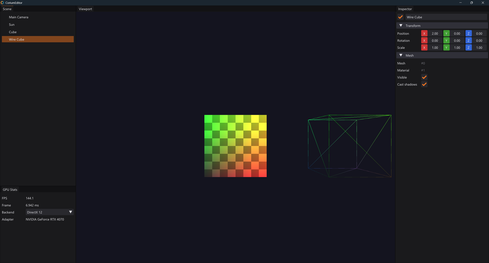

# CoriumEngine

## /!\ This is a work in progress during my free time:

Changes are happening sometimes months after the last commit, but I still love this type of development, so I hope you will judge it with a good eye ;)

**Current state of the editor :**

## What's new since the last update

- **Two rendering backends: DirectX 12 and Vulkan 1.3**, behind an in-house RHI abstraction. The backend is picked at launch (`-dx12` / `-vulkan`) or from the editor's GPU Stats panel (applied on next launch).
- **A real editor** (`CoriumEditor`), separate from the runtime (`CoriumRuntime`): docked ImGui layout with a scene hierarchy, a viewport rendered offscreen, a per-component inspector and GPU stats.
- **Editor camera** (right click + ZQSD), frame clock (`dt`) and raw input handling.
- **Scene serialization**: scenes are saved/loaded from a small YAML-like text format (`Assets/Scenes/*.scene`), entities have a persistent 64-bit UUID.
- **In-house math library** (vectors, matrices, quaternions) replacing DirectXMath.
- **Cleaner architecture**: the engine is a DLL hiding DirectX/Vulkan/ImGui behind a public API, with the window and main loop shared by both executables.
- Shaders compiled at build time by DXC to both DXIL and SPIR-V.

## Libraries

Current libraries used in the project are:

- [DirectX 12](https://learn.microsoft.com/en-us/windows/win32/directx) and [Vulkan 1.3](https://www.vulkan.org/) for rendering
- [Vulkan Memory Allocator](https://github.com/GPUOpen-LibrariesAndSDKs/VulkanMemoryAllocator) for Vulkan memory management
- [DXC](https://github.com/microsoft/DirectXShaderCompiler) for shader compilation (HLSL → DXIL / SPIR-V)
- [Dear ImGui](https://github.com/ocornut/imgui) (docking branch) for the editor UI

Dependencies are managed using [vcpkg](https://github.com/microsoft/vcpkg)

## Future of the project:

The detailed roadmap lives in [doc/Roadmap.md](doc/Roadmap.md).
The goal is still to have a little editor to manage the assets and the scenes, without touching the code, and be able to make little POCs of physics simulations, or little games, with the engine.

## Thanks for reading and see you in the next update! :D
